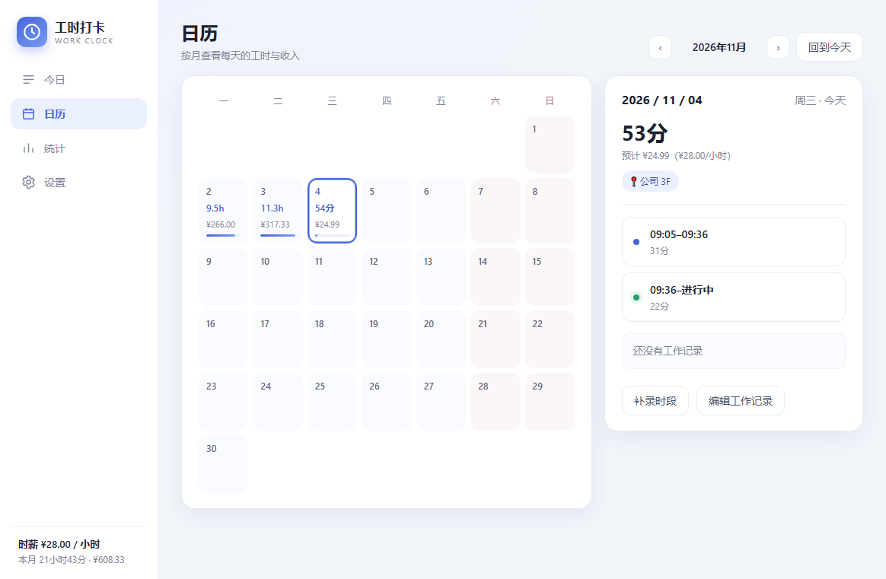
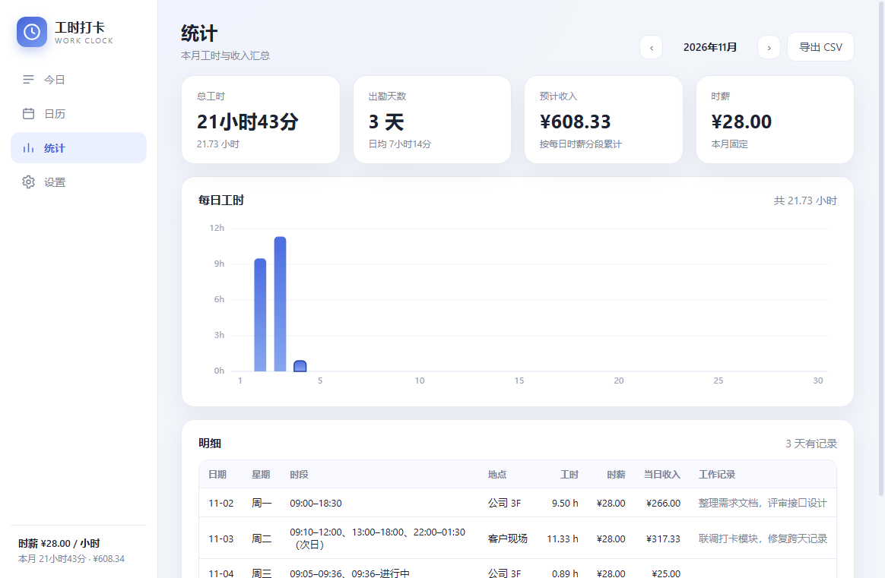

# 工时打卡 Work Clock


一个离线的 Windows 桌面打卡工具：每天上下班打卡，自动累计本月工时，并按固定时薪算出这个月能挣多少钱。数据只存在本机，不联网、不需要账号。

| 今日 | 日历 |
| --- | --- |
|  |  |
| **统计** | **设置** |
|  |  |

## 功能

- **今日**：一键上班 / 下班打卡，实时显示今天已工作多久、今天赚了多少；未打卡的时段可以手动补录，跨零点也能记。
- **工作记录与地点**：每天一段文字记录（做了什么）+ 一个上班地点，地点输入框会自动联想最近用过的地点。
- **日历**：按月查看每天的工时和收入，点某一天看当天所有时段、地点和记录。
- **统计**：本月总工时、出勤天数、日均工时、预计收入；每日工时柱状图；明细表（日期 / 星期 / 时段 / 地点 / 工时 / 时薪 / 当日收入 / 记录）可导出 CSV。
- **时薪管理**：时薪只需设置一次；涨薪时新增一条带生效日期的时薪，历史月份金额保持不变。
- **数据安全**：每次保存自动留上一版备份，每天自动归档一份（保留最近 14 份）；数据文件损坏时自动回退到备份；设置页支持导出 / 导入 JSON、恢复历史备份、清空数据。
- **托盘常驻**：点窗口右上角 × 默认隐藏到任务栏托盘，程序继续运行；左键托盘图标恢复窗口，右键菜单可「打开主界面 / 退出」。设置页可关闭该行为，改为点 × 直接退出。

## 环境要求

**使用**：Windows 10 / 11（64 位）。免安装，不需要 Node.js，也不需要联网。

**从源码开发 / 打包**：Node.js 18 及以上（本项目在 Node v24.19.0 + Windows 10 19044 上验证），Windows 环境。

## 快速开始

1. 从 [Releases](https://github.com/Fanghonglai/WorkCloock/releases) 下载 `WorkClock-1.0.3-win64.zip`，解压到任意目录（例如 `D:\software\工时打卡`），双击目录里的 `工时打卡.exe` 运行（免安装，不需要 Node.js）。
2. 第一次打开会弹出「先设置你的时薪」，填上时薪（元/小时）和生效日期，保存。
3. 到公司点「上班打卡」，下班点「下班打卡」。忘了打卡就在日历页或今日页点「补录时段」。
4. 月底打开「统计」页，看本月总工时和预计收入，需要的话点「导出 CSV」。

数据默认保存在 `%APPDATA%\work-clock\data.json`（在文件资源管理器地址栏输入 `%APPDATA%\work-clock` 可直接打开），关闭软件不会丢。点 × 默认只是隐藏到托盘，要彻底退出请用托盘右键菜单的「退出」。

## 一个完整的工作日

1. **设置时薪**（只需一次）：设置页 → 时薪填 `28`、生效日期选入职或本月 1 日 → 保存。
2. **上班打卡**：今日页点蓝色按钮「上班打卡」。按钮变为「下班打卡」，下方出现一条进行中的时段，金额每秒刷新；打卡成功后会提示这条记录按整点归整到了几点。
3. **记录工作内容**：在「工作记录」卡里填地点（如 `公司 3F`）和当天做了什么，失焦或停顿后自动保存，右侧显示「已保存」。
4. **下班打卡**：点「下班打卡」，提示「已下班（记为 …）」，当天工时定稿。
5. **补录**：如果忘了打卡，点「补录时段」，选日期、开始 / 结束时间，也可以顺手填当天的工作地点；结束时间早于开始时间说明跨了零点，勾选「次日结束」。日历页的「编辑工作记录」同样可以补地点和备注。
6. **查看与导出**：统计页确认本月工时与收入，点「导出 CSV」用 Excel / WPS 打开（已带 UTF-8 BOM，中文不乱码）。

## 计算规则

- 工时归到**打卡开始那天**；跨零点的那一段算开始日（例如 22:00 到次日 01:30 记在开始日）。
- 一天可以有多段打卡；正在进行的时段按当前时间实时计入。
- **计时按整点归整**：打卡时间不记分钟。分钟 0–29 归到当前整点，31–59 归到下一整点；正好 `x:30` 整（不含秒）视为“端口”，保留半小时按实际时间计算。例如 1:30–2:30 之间（不含两端）都记为 2 点；正好 1:30 或 2:30 则记 1:30 / 2:30。补录和编辑时间同样归整，归整后上下班同点会提示调整。
- 某天的时薪 = 生效日期不晚于该天的**最新一条**时薪；如果该天早于最早一条时薪的生效日期，则回退使用最早一条。
- 当日收入 = 该段毫秒数 ÷ 3600000 × 当天时薪；月总额把各天金额相加后四舍五入到分。不做加班倍率、节假日倍率，也不按 15 分钟取整（只按上面的整点规则归整打卡时间）。
- **修改时薪的影响**：新增一条时薪只对该生效日期及之后生效，之前月份金额不变；如果删除或修改某条历史时薪，它覆盖的时间段会被重新计算。

## 数据、备份与迁移

| 文件 | 说明 |
| --- | --- |
| `%APPDATA%\work-clock\data.json` | 当前数据（打卡记录、时薪、备注、地点、窗口位置） |
| `%APPDATA%\work-clock\data.bak.json` | 上一次保存前的自动备份 |
| `%APPDATA%\work-clock\backups\data-YYYYMMDD.json` | 每天首次写入时归档，保留最近 14 份 |

- 启动时如果 `data.json` 读不出来（例如被手动改坏），会依次尝试 `data.bak.json` 和最近的每日备份，并在界面顶部提示发生过的回退；坏文件会保留为 `data.corrupt-<时间戳>.json` 方便排查。
- 换电脑：设置页「导出数据」得到 JSON 文件，在新机器上「导入数据」即可；导入 / 恢复备份前会自动再留一份安全备份。
- 清空数据会删除全部记录，操作前有二次确认。

## 工程结构

```
work-clock/
├─ package.json            # 脚本、electron-builder 打包配置
├─ LICENSE                 # MIT 许可证
├─ CHANGELOG.md            # 版本更新记录
├─ README.md               # 项目说明
├─ build/icon.png          # 应用与安装包图标
├─ src/
│  ├─ main/
│  │  ├─ main.js           # 主进程：窗口、IPC、CSV/JSON 导出、冒烟截图模式
│  │  └─ store.js          # 数据层：读写、校验、去重、备份与损坏恢复
│  ├─ preload.js           # contextBridge 暴露最小 API
│  ├─ shared/calc.js       # 纯计算核心（时长、时薪分段、月统计、格式化），主/渲染进程共用
│  └─ renderer/
│     ├─ index.html        # 四个页面骨架
│     ├─ styles.css        # 界面样式
│     └─ app.js            # 渲染与交互逻辑
├─ test/
│  ├─ calc.test.js         # 计算核心 18 个用例
│  └─ store.test.js        # 数据层 17 个用例
├─ docs/screenshots/       # 界面截图
└─ dist/                   # 打包产物（构建生成，已被 .gitignore 忽略）
```

## 开发与测试

```powershell
cd work-clock
cmd /c npm install          # PowerShell 若拦截 npm.ps1，用 cmd /c npm.cmd install
cmd /c npm start            # 本地启动应用
cmd /c npm test             # 依次运行 calc 与 store 测试
```

也可以单独运行某个测试文件（不通过 node --test，避免子进程权限问题）：

```powershell
node test/calc.test.js
node test/store.test.js
```

调试时可以用独立的数据目录，避免污染真实数据：

```powershell
$env:WORKCLOCK_DATA_DIR = "$PWD\.cache\debug-data"
cmd /c npm start
```

### 打包

```powershell
$env:TEMP = "$PWD\.cache\tmp"; $env:TMP = "$PWD\.cache\tmp"
$env:ELECTRON_CACHE = "$PWD\.cache\electron"
$env:ELECTRON_BUILDER_CACHE = "$PWD\.cache\builder"
$env:CSC_IDENTITY_AUTO_DISCOVERY = "false"
cmd /c npm run dist
```

产物为 `dist\WorkClock-<版本>.exe`（portable 免安装）。国内网络可再设置 `ELECTRON_MIRROR=https://npmmirror.com/mirrors/electron/` 与 `ELECTRON_BUILDER_BINARIES_MIRROR=https://npmmirror.com/mirrors/electron-builder-binaries/`。打包第一次运行会下载 Electron 与 NSIS 资源，比较慢。

## 常见问题

- **双击 exe 没反应**：zip 版要先完整解压再运行（不要在压缩包里直接双击）；若还不行，检查杀毒软件是否拦截，或改用 `npm run dist:dir` 生成的 `dist\win-unpacked\工时打卡.exe`。
- **终端里 `npm start` 起不来**：如果环境里设置过 `ELECTRON_RUN_AS_NODE=1`，先执行 `Remove-Item Env:ELECTRON_RUN_AS_NODE` 再启动。
- **点了 × 程序还在运行**：默认开启“关闭到托盘”，这是正常行为；要彻底退出，右键任务栏托盘里的时钟图标 →「退出」，或在设置页关闭该开关。
- **改了时薪，上个月金额变了**：说明改的是历史时薪记录；应当新增一条时薪并选择新的生效日期，历史月份就不会动。
- **跨零点的班怎么记**：正常打卡即可，工时算在开始那天；补录时勾选「次日结束」。
- **数据文件被改坏**：重新打开软件，会自动从备份回退并在顶部提示；确认无误后可在设置页手动恢复某天的备份。

## 已知限制

- 单机单用户，没有云同步和多设备合并。
- 只统计软件里记录的时间，不读取考勤系统。
- CSV 是 UTF-8 BOM 编码，适合 Excel / WPS；其他工具若显示乱码请按 UTF-8 打开。
- 没有自动更新，升级需要下载新版 zip 覆盖程序目录（`%APPDATA%\work-clock` 里的数据不受影响）。

## 版本与更新

当前版本 **1.0.3**，变更记录见 [CHANGELOG.md](CHANGELOG.md)。遇到问题或有建议，欢迎提 [GitHub Issue](https://github.com/Fanghonglai/WorkCloock/issues)。

## 许可

[MIT License](LICENSE) © 2026 Fanghonglai